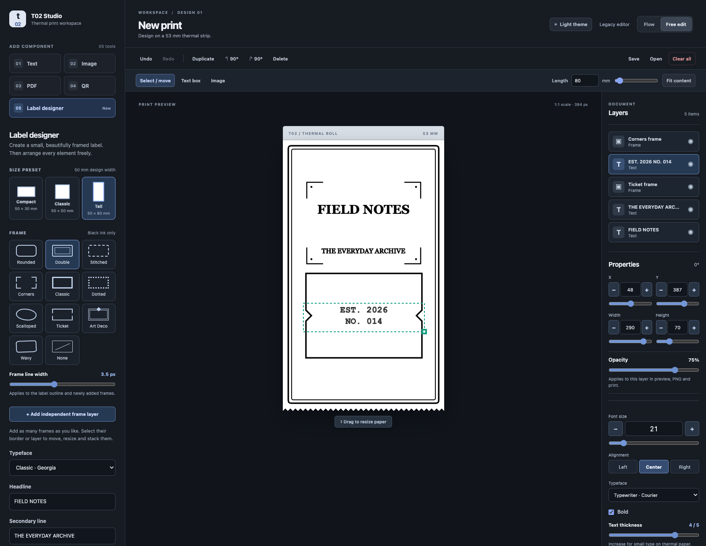
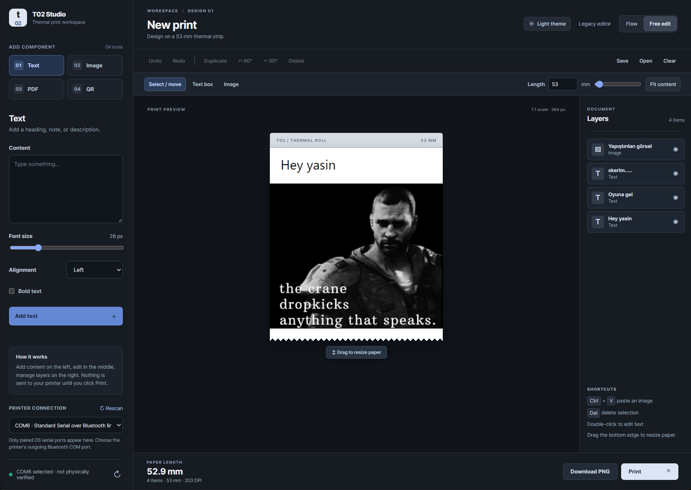

# T02 Studio

**A free, open-source visual editor for Phomemo T02 thermal printers.** Design and print custom labels, stickers, images, barcodes, and more.

T02 Studio is an independent community project and is **not affiliated with or endorsed by Phomemo**.

**Windows users:** [Download the latest `T02-Studio.exe` from Releases](https://github.com/FlyzDev/t02-studio/releases/latest). No Python, terminal or manual build required. Double-click the EXE to open the editor, leave its console window open while printing, and close the window when finished. The Windows build is unsigned, so verify the published SHA256 checksum if SmartScreen warns. **Never run as Administrator.**

T02 Studio combines text, images, PDF extracts, QR codes and real retail barcodes into one 384-dot-wide strip. Its free-layout editor supports dragging, resizing, 90° rotation, an adjustable paper edge, paste-to-add images, shapes, borders, layers, project JSON and PNG export.

**Graphics-editor workspace:** the main editor has a compact File / Edit / View / Layer menu, a vertical selection and component tool rail with centered vector icons, a central canvas, and a right-hand Properties / Layers inspector. Choose a left-rail tool to display its contextual options in an aligned horizontal ribbon below the fixed top toolbar. The ribbon overlays just the canvas column, so neither the paper nor the Properties / Layers inspector shifts when it opens or closes. The fixed row keeps **Undo / Redo**, layer centering, and paper controls available. Click **Size**, **Weight**, or **Opacity** for an anchored live slider below the control; Size and Opacity keep editable numeric inputs. Drag Layers rows by their grip to reorder the stack. The bottom status bar contains zoom, PNG export, and Print. Shortcuts: **V** selects, **T** opens text, **Ctrl+S** saves. Older locally saved designs remain compatible. The Classic and legacy composer views are still available.

**Multi-layer selection:** in **Free edit**, choose **Select / box-select** and drag over empty paper **or the gray workspace around it** to draw a selection rectangle, just like selecting desktop icons. Drag any selected element to move the selection together, or drag the group's bottom-right corner to resize all selected layers. Hold **Shift while dragging** to constrain movement to the dominant horizontal or vertical axis; releasing Shift allows fluid free movement. Shift-click elements on the canvas, or Ctrl/Shift-click rows in the Layers panel to add/remove them from the selection. Each layer has its own `×` delete button; Delete/Backspace removes the current selection. Ctrl+A selects all visible layers, Esc deselects, and Undo reverses edits.

## Preview



*Field Notes showcase: a tall 50 × 80 mm label with a double outer border, independent corners and ticket frames, Georgia/Courier typography, thicker small text, and a 75% opacity layer. The [editable project JSON](examples/field-notes-014.json) and [print-ready PNG](examples/field-notes-014-print.png) are included.*

<details>
<summary>Original free-edit preview</summary>



*Free-edit mode, with live preview, draggable paper edge, and layers. The sample text and third-party artwork shown in this user-supplied screenshot are illustrative content, not bundled editor assets or part of the software license.*

</details>

## Interfaces

| Route | Purpose |
| --- | --- |
| `/` and `/alt` | Main Photoshop-inspired workspace: menu bar, compact tool rail, central canvas, Properties / Layers inspector, **dark by default** |
| `/composer` | Legacy full receipt composer |
| `/classic` | Legacy one-item-at-a-time editor |

All three interfaces use the same local backend. The alternate design is native HTML/CSS/JavaScript inspired by neutral design-system primitives; it does **not** bundle React or shadcn components.

## Label designer

Open **Label designer** from the left tool rail to start with a ready-to-edit label:

- Three presets: **50 × 30**, **50 × 50**, and **50 × 80 mm**.
- Eleven monochrome frame choices: no frame, rounded, double, stitched, corners, classic, dotted, scalloped, ticket, Art Deco, and wavy.
- **Add independent frame layer** creates another resizable frame over the same canvas. Stack, duplicate, reorder or delete frame layers individually; click their border or select them from Layers to edit their style.
- The **Frame line width** slider ranges from 1 to 7 px (0.5 px increments), defaulting to a stronger 3 px. The label outline and each frame layer have independent, editable line widths.
- Six offline system-font families, including editorial serif, rounded, bold display, and typewriter. Each text layer can change its typeface independently.
- **Text thickness** (1–5) adds a controllable ink stroke around glyphs for better legibility on 203 DPI thermal paper. New text defaults to 4/5; label headlines start at 3/5 and smaller secondary lines at 4/5. Each text layer has its own setting.
- Selected-item Properties includes **X, Y, Width and Height** sliders with ±1 px buttons alongside exact numeric fields. Font size has a slider and stepper, while alignment uses Left / Center / Right buttons. Hold Shift while clicking ± to move in 10 px/point steps. Geometry editing remains available only in Free edit.
- Editable headline and secondary line; labels open directly in Free edit for repositioning and resizing. Changing a preset or frame can update an existing label.
- Every text, image, PDF/QR image and frame layer has an **Opacity (0–100%)** slider. Partially transparent ink is composited against the paper's white background; the resulting gray levels are dithered for the monochrome printer.
- Frames, stroke weights, text thickness, per-layer opacity, dimensions, and font choices persist in project JSON and are rendered through the same canvas path for on-screen preview, PNG, and print. Older version-2 projects without weight or opacity values load with safe new defaults.
- The toolbar **Clear all** button asks for confirmation before removing every layer and the label outline, and the operation can be reversed with **Undo**. It does not delete saved JSON files.

## Components

The main editor includes ten component tools:

| Tool | What it adds |
| --- | --- |
| Text | Free text with typography, alignment and variable ink thickness |
| Image | Photos, logos and pasted pictures |
| PDF | Rendered PDF segments |
| QR | Compact QR square with a scanner-friendly quiet zone; no baked-in caption or receipt-sized margins |
| Barcode | Real **Code 128** or **EAN-13** barcode with optional printed numbers |
| Address | Editable multiline address text, with no geolocation or online lookups |
| Date / time | Current local date/time as editable text, captured when inserted |
| Shape | Rectangle, rounded rectangle, ellipse, line, arrow, diamond or star, filled or outlined |
| Border | Independently movable and stackable decorative frame layers |
| Label designer | Three label size presets with typography and frame options |

The new shapes inherit the same free-positioning, opacity, sizing, rotation, undo/redo, JSON persistence and raster export path as other layers. Barcodes are generated locally; verify real scanner performance on printed paper, especially with longer Code 128 values that may become too dense at 203 DPI. EAN-13 requires 12 digits (checksum calculated) or a valid 13-digit number (checksum verified).

These are layout presets for **53 mm continuous-roll paper** with approximately 50 mm of artwork width. They are not calibration profiles for precut die-cut stickers or separate label media. Font appearance may vary if another computer does not have the same desktop fonts; exporting a PNG rasterizes the chosen appearance.

## Quick start (Windows)

If you are not developing the app, use the standalone EXE linked above. The steps below are for running from source.

Prerequisites: Python 3.11+, a Phomemo T02 Mini or compatible serial printer, and Bluetooth enabled on your Windows PC. Pair the printer in **Windows Bluetooth settings** first. The USB cable on some models may only charge the device.

1. Clone this repository.
2. In PowerShell, from the project directory:

   ```powershell
   .\start.ps1
   ```

3. Open <http://127.0.0.1:8062/>.
4. Under **Printer connection**, click **Rescan**, then select your printer's outgoing Bluetooth COM port. The selection is remembered in that browser.

The discovery list shows serial ports already registered by the operating system, labeled as Bluetooth / USB / serial when available. It prioritizes identifiable T02/Phomemo entries and may automatically select an unambiguous Bluetooth port. Some Windows drivers expose generic names such as *Standard Serial over Bluetooth link*; if several appear, choose the **outgoing** COM port shown under Windows Bluetooth's **More Bluetooth options → COM Ports**. The app never sends a test print during discovery and cannot guarantee a listed printer is powered on. It does not scan nearby unpaired devices or handle Bluetooth pairing.

Nothing prints until you explicitly press **Print**. An ordinary PNG export doesn't use the printer. No COM port environment variable is needed for the main editor; `T02_COM_PORT` remains optional for scripts and legacy interfaces.

### Optional trusted home-LAN access

The application deliberately starts on localhost and permits localhost requests by default. **There is no login screen**. Only enable LAN access on a trusted private network.

For example, if the host PC's private LAN address is `192.168.1.50` and the trusted subnet is `192.168.1.0/24`:

```powershell
$env:T02_BIND_HOST = '192.168.1.50'
$env:T02_ALLOWED_NETWORKS = '192.168.1.0/24'
.\start.ps1
```

If needed, create a **narrow Windows Firewall inbound rule** for only that PC's IP, port 8062, the trusted source subnet, and the Private network profile. This repository does not create a broad firewall rule automatically.

**Never port-forward this service to the Internet or expose it to guest Wi-Fi.** A device allowed to access the app can submit print jobs without authentication. Requests from non-allowlisted IPs and cross-site browser print requests are blocked, but those are not substitutes for network isolation.

## Features

- Compose a long strip from multiple blocks (text, image, PDF segment, QR, Code 128, EAN-13, address, date/time, and vector-style shapes).
- Discover paired Windows serial ports, identify likely T02 entries, and remember the selected outgoing COM port per browser. Supports multiple LAN clients selecting ports independently.
- Flow and free-layout modes; clipboard image paste and drag/drop.
- Rectangle marquee, multi-layer move/resize, Shift/Ctrl multi-select, inline layer removal, and undoable bulk deletion.
- Label designer presets, stackable frame layers, 0–100% layer opacity, and typography controls, with no external font CDN requirement.
- Adjustable 20–999 mm free canvas, including a draggable bottom paper edge.
- Rotate blocks left/right by 90°, drag to position, resize, re-order, hide or delete.
- PDF: text reflow, original fit, tiling, page ranges and bounded multi-segment previews.
- Optional local OCR for scanned PDFs when Tesseract and language data are installed.
- Local-only project autosave, JSON import/export, full-resolution PNG export.
- A single locked print path with per-job identifiers to reduce accidental duplicate submissions.

## Development

```powershell
py -3 -m venv .venv
.\.venv\Scripts\python.exe -m pip install -r requirements.txt
.\.venv\Scripts\python.exe -m unittest discover -s tests -v
node tests/test_studio_core.js
```

The Python tests fake the serial printer and **do not print physical paper**. The JavaScript geometry tests run in Node; no browser-side build step is required.

## Project boundaries

- Thermal output is monochrome, 384 dots wide, with a maximum 8,000-pixel single job.
- Printing is over a Windows Bluetooth serial COM port; this is **not** a universal Windows print driver.
- Printer power-save and physical paper feed cannot be reliably inferred merely from a registered COM port.
- Port discovery and selection are read-only until **Print** is clicked. Port labels are an aid, not proof of printer identity; other Bluetooth and USB serial devices may also appear.
- The app stores no uploaded documents on the server. Browser local storage and downloaded JSON/PNG copies can retain document data.
- Tested principally on a Phomemo T02 Mini. Support for other models is not claimed.

## License and acknowledgement

T02 Studio is released under **GNU AGPL-3.0-only**. See [LICENSE](LICENSE). It uses PyMuPDF, which is available under the AGPL or a separate commercial license. Check the licenses of all dependencies if you redistribute modified builds. The [vivier/phomemo-tools](https://github.com/vivier/phomemo-tools) repository was a research reference for T02 interoperability; consult its GPL-3.0 license independently.

Contributions are welcome; see [CONTRIBUTING.md](CONTRIBUTING.md). The project is community-supported and provided without warranty.
